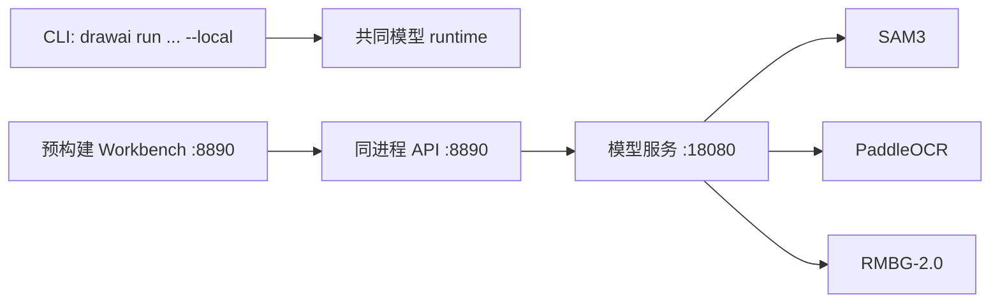

# DrawAI 运行方式与参数说明

这份文档专门放细节：端口、设备、模型目录、环境变量和常见部署组合。统一安装与按需依赖先看 [安装指南](installation.md)。本文保留底层模型服务、设备与管线命令的细节。

## 一张图看懂进程关系



最常见的三种形态：

- 🙂 单机 CLI：`drawai run ... --local` 直接在当前机器跑完整流程。
- 🧑‍💻 单机 Workbench：`drawai workbench` 同进程提供预构建前端和 API；加 `--start-model` 启动已准备的模型服务。
- 🖥️ 分离部署：`drawai server model` 在模型机器上跑，Workbench 或 API 通过 HTTP 连接它。

## 命令速查

| 目标 | 命令 |
| --- | --- |
| 准备并检查本地运行时 | `drawai setup local` |
| 检查本地运行时 | `drawai doctor local` |
| 单张图片本地运行 | `drawai run <image> --local` |
| 启动完整 Workbench | `drawai workbench` |
| 只启动模型服务 | `drawai server model` |
| 只启动 Workbench API | `drawai server api` |
| 前端连接已有 API | `drawai workbench --api http://<api-host>:8890` |
| 配置文件全流程 | `drawai run all --config configs/drawai/config.yaml` |
| 重新处理单个元素素材 | `drawai asset process <run_dir> <element_id> --processor crop` |
| 切换元素素材结果 | `drawai asset activate <run_dir> <element_id> <result_id>` |
| 基于数据包重新生成 SVG | `drawai compose <run_dir>` |
| 基于数据包重新导出 | `drawai export <run_dir>` |

## 本地 setup

默认命令：

```bash
drawai setup local
```

它会做四件事：

1. 下载模型文件到 `~/.drawai/runtime`
2. 创建 `~/.drawai/runtime/.venv`
3. 安装 DrawAI 本地运行时依赖
4. 自动执行一次 `drawai doctor local`

常用参数：

| 参数 | 默认值 | 说明 |
| --- | --- | --- |
| `--runtime-root` | `~/.drawai/runtime` | 本地 runtime 目录 |
| `--source` | `modelscope` | 模型来源，可选 `modelscope` 或 `huggingface` |
| `--device` | `cpu` | 安装和运行设备配置，可选 `cpu`、`gpu`、`mps`、`auto` |
| `--python` | `3.12` | runtime venv 使用的 Python 版本 |
| `--download-only` | 关闭 | 只下载模型，不创建 venv |
| `--bootstrap-only` | 关闭 | 只创建或刷新 venv，不下载模型 |
| `--skip-doctor` | 关闭 | 完整 setup 后不自动执行 doctor |
| `--dry-run` | 关闭 | 只打印计划，不实际下载或安装 |

`--download-only`、`--bootstrap-only` 和 `--dry-run` 不会自动执行 doctor；这些分段命令完成后可以手动运行 `drawai doctor local`。

doctor 会同时检查 `~/.drawai/runtime/.venv` 和当前 Workbench/API 所在的项目 Python 环境，避免出现 runtime 检查通过但 SVG 生成阶段缺少 Codex SDK 的情况。

Hugging Face 下载：

```bash
export HF_TOKEN=hf_...
drawai setup local --source huggingface --accept-sam3-license
```

手动提供 SAM3：

```bash
drawai setup local \
  --sam3-source /path/to/facebookresearch-sam3 \
  --sam3-checkpoint /path/to/sam3.pt \
  --sam3-bpe /path/to/bpe_simple_vocab_16e6.txt.gz
```

## 设备配置

| `--device` | SAM3 | RMBG | PaddleOCR | 适合场景 |
| --- | --- | --- | --- | --- |
| `cpu` | CPU | CPU | CPU | 默认、最稳、安装压力最低 |
| `gpu` | CUDA | CUDA | CPU | Linux + NVIDIA GPU |
| `mps` | CPU | MPS | CPU | Apple Silicon，本地轻量加速 |
| `auto` | 自动 | 自动 | CPU | 已经自己管理环境时使用 |

GPU setup 会根据 `nvidia-smi` 里的 CUDA runtime 版本选择 PyTorch wheel 后端。也可以手动指定：

```bash
drawai setup local --device gpu --torch-backend cu126
drawai setup local --device gpu --torch-backend cu128
drawai setup local --device gpu --torch-backend cu130
```

如果你已经在 runtime venv 里装好了合适的 `torch` 和 `torchvision`：

```bash
drawai setup local --skip-torch-install
```

## 模型文件路径

默认 runtime 目录结构：

```text
~/.drawai/runtime/
  .venv/
  source/
    sam3/
  models/
    sam3/
      sam3.pt
      bpe_simple_vocab_16e6.txt.gz
    paddlex/
      official_models/
        PP-OCRv5_server_det/
          inference.pdiparams
        PP-OCRv5_server_rec/
          inference.pdiparams
    rmbg2/
      model.safetensors
  tools/
```

这些文件默认不进入 git。换 runtime 目录时，setup、run、server 都要指向同一个 `--runtime-root`。

## 单图 CLI

最短命令：

```bash
drawai run examples/demo_figure.png --local
```

常用参数：

| 参数 | 默认值 | 说明 |
| --- | --- | --- |
| `--local` | 必填 | 使用本地 in-process runtime |
| `--device` | `cpu` | `cpu`、`gpu`、`mps`、`auto` |
| `--run-name` | `local_single_svg_ppt` | 输出目录名字的一部分 |
| `--out` / `--run-root` | `runs` | 运行结果根目录 |
| `--runtime-root` | `~/.drawai/runtime` | 本地 runtime 目录 |
| `--base-config` | `configs/drawai/config.yaml` | 基础配置文件 |
| `--dry-run` | 关闭 | 只生成运行清单和配置，不实际跑模型 |

注意：这个单图快捷命令是本机 in-process 模式。如果要让 CLI 调远程模型服务，请使用配置文件分阶段运行，并把配置里的 SAM3、OCR、RMBG 地址改成远程模型服务地址。

## Agent CLI 后端

默认配置使用 Codex Python SDK。要把 run0 资产分析和 SVG 生成都切到外部 Agent CLI，配置里需要同时设置：

```yaml
svg:
  generation_backend: agent_cli
model_runtime:
  provider: agent-cli
  connection_id: hermes
  cli:
    agent: hermes
```

`model_runtime.cli.agent` 支持 `kimi`、`claude`、`codex`、`openclaw`、`hermes` 和 `custom`。内置 preset 会在未写 `command` 时使用默认命令：

| agent | 默认命令 | 说明 |
| --- | --- | --- |
| `kimi` | `kimi` | 通过 stdin 接收 prompt，并自动补 `--work-dir`、`--print`、`--yolo` 等参数 |
| `claude` | `claude` | 通过 stdin 接收 prompt，并自动补 `--print`、`--permission-mode bypassPermissions` |
| `codex` | `codex exec` | 通过 stdin 接收 prompt，并自动补工作目录、图片参数和 sandbox/approval 参数 |
| `openclaw` | `openclaw agent` | 使用 `openclaw agent --local --agent main --message ... --json` 运行本地 agent |
| `hermes` | `hermes chat` | 使用 `hermes chat --query ... --quiet --yolo` 运行单轮 agent |
| `custom` | 无 | 必须显式写 `model_runtime.cli.command` |

如果想覆盖默认命令，可以写完整命令数组：

```yaml
model_runtime:
  provider: agent-cli
  connection_id: openclaw
  cli:
    agent: openclaw
    command:
      - openclaw
      - agent
```

OpenClaw 和 Hermes 的 prompt 会作为 CLI 参数传入；DrawAI 的 trace 只记录 `<prompt:... chars>` 占位，不会把完整 prompt 写进命令日志。

## OpenHands ACP 后端

OpenHands 通过 ACP JSON-RPC stdio 接入 DrawAI，而不是解析 headless CLI 文本。内置 preset 为 `openhands`，Workbench provider id 为 `openhands_acp`，默认启动命令是：

```text
openhands acp --always-approve
```

### 安装当前已验证版本

截至当前验证，PyPI 上的 OpenHands CLI/SDK 组合不会把 subscription 标记完整序列化到 `agent_settings.json`，进程重启后会丢失订阅模式。下面的官方仓库 source pin 包含该持久化修复，且已经通过真实订阅调用和 DrawAI ACP 调用验证：

```bash
uv tool install --force --python 3.12 \
  'openhands @ git+https://github.com/OpenHands/OpenHands-CLI.git@2df8a2835d3f1bd2f2eadf5a7a2e1ad0dfb0d271'

uv pip install --python "$(uv tool dir)/openhands/bin/python" \
  --force-reinstall --no-deps \
  'openhands-sdk @ git+https://github.com/OpenHands/software-agent-sdk.git@53155aa636738c2c6eed445f928de83a181034f8#subdirectory=openhands-sdk' \
  'openhands-tools @ git+https://github.com/OpenHands/software-agent-sdk.git@53155aa636738c2c6eed445f928de83a181034f8#subdirectory=openhands-tools' \
  'openhands-workspace @ git+https://github.com/OpenHands/software-agent-sdk.git@53155aa636738c2c6eed445f928de83a181034f8#subdirectory=openhands-workspace'

openhands acp --help
```

上游正式版本包含 subscription 序列化修复后，可以改回普通的 `uv tool install openhands --python 3.12`。

### 使用 ChatGPT/Codex 订阅授权

OpenHands 需要自己的 OAuth grant。可以选择与 `codex login status` 对应的同一个 ChatGPT 账号，但不要复制或软链接 `~/.codex/auth.json`。以下命令会打开 OpenAI 登录页，把 OpenHands 凭据写入 `~/.openhands/auth/`，并通过 `AgentStore` 持久化默认 Agent：

```bash
OPENHANDS_PYTHON="$(uv tool dir)/openhands/bin/python"
OPENHANDS_SUPPRESS_BANNER=1 "$OPENHANDS_PYTHON" - <<'PY'
from openhands.sdk import LLM
from openhands_cli.stores import AgentStore
from openhands_cli.utils import get_default_cli_agent

llm = LLM.subscription_login(vendor="openai", model="gpt-5.4-mini")
AgentStore().save(get_default_cli_agent(llm))
print(llm.model, llm.auth_type, llm.is_subscription)
PY
```

模型可用性取决于 ChatGPT 账号和 Codex 网关。完整 DrawAI 端到端验证使用 `gpt-5.4-mini`；同一账号也完成过 `gpt-5.5` 单轮调用，但更容易触发订阅用量限制。如果网关返回 model not supported，应从本机 `~/.codex/models_cache.json` 和当前 OpenHands 注册表的交集中选择型号，并重新保存 Agent。可用下面的真实单轮调用检查授权、模型和持久化状态：

```bash
OPENHANDS_SUPPRESS_BANNER=1 openhands --headless --json --always-approve \
  -t 'Reply with exactly OPENHANDS_SUBSCRIPTION_OK. Do not modify files.'
```

### DrawAI 配置

下面是已经对完整 `drawai run` 验证过的单回合配置。它保留真实 SAM3/OCR、资产处理、SVG 校验、渲染和 PPTX 导出，只把 SVG 模型阶段切换到 OpenHands ACP：

```yaml
v2:
  enabled: true
  refine:
    enabled: false
svg:
  generation_backend: acp_agent
  staged_generation: false
  visual_review_rounds: []
model_runtime:
  provider: acp-agent
  connection_id: openhands
  timeout_seconds: 3600
  max_concurrent: 1
  acp:
    agent: openhands
```

`v2.refine.enabled: false` 表示这条单命令不等待外部预生成的 run0 refine JSON；`staged_generation: false` 和空 review rounds 把订阅模型调用收敛为一个真实 SVG 生成回合。需要最高重建质量时可以恢复分阶段生成与视觉 review，但会消耗更多订阅额度。run0 分析脚本同样接受 `--acp-agent openhands`，并可把 `openhands acp --always-approve` 作为 `--acp-agent-command` 的剩余参数传入。

未显式设置 `model_runtime.acp.command` 时，DrawAI 使用 preset 中的 `openhands acp --always-approve`。如需固定绝对路径或添加 OpenHands 参数，可写完整命令数组：

```yaml
model_runtime:
  provider: acp-agent
  connection_id: openhands
  acp:
    agent: openhands
    command:
      - /absolute/path/to/openhands
      - acp
      - --always-approve
```

`--always-approve` 只用于允许 OpenHands 在隔离任务目录中无人值守地写入 DrawAI 要求的 SVG/JSON 产物；ACP trace 仍会保存协议请求、响应和 Agent 通知，便于审计真实执行路径。

### OpenHands ACP 大文件兼容行为

OpenHands 当前的 stdio 启动器使用较小的默认单行缓冲区，而 ACP 图片块会把本地图片编码成很大的单行 base64 JSON。DrawAI 的 `openhands` preset 因此保留图片能力，但不内联图片块：受控 prompt 提供绝对本地图片路径，OpenHands 使用自己的图片/file editor 能力读取它。trace 中会记录 `inline_image_blocks: false`。其他 ACP provider 的内联图片行为不变。

OpenHands 的交互终端也不适合承载整份长 SVG here-doc。DrawAI 会明确要求 OpenHands 使用 `file_editor` 写 SVG/JSON，只用短终端命令运行 `xmllint` 或项目提供的 validator。这个路径已经用 22 KB SVG 压力测试和完整图片流程验证，不需要修改 OpenHands 的 site-packages。

## Workbench

完整本机 Workbench：

```bash
drawai workbench
```

它会启动：

| 进程 | 默认地址 | 作用 |
| --- | --- | --- |
| 模型服务 | `http://127.0.0.1:18080` | SAM3、PaddleOCR、RMBG |
| Workbench API | `http://127.0.0.1:8890` | 任务、文件、流水线调度、Codex 调用 |
| 预构建前端 | `http://127.0.0.1:8890` | 与 API 同进程的浏览器界面；开发模式前端默认 5174 |

源码开发启动器（`--dev`）会优先用 `tmux` 管理这几个后台进程；如果系统没有安装 `tmux`，会自动降级为 `nohup`，日志仍然写到 `.local/drawai-local-services.log`、`.local/workbench-api.log` 和 `.local/workbench-frontend.log`。

局域网访问：

```bash
drawai workbench --host 0.0.0.0
```

访问时不要写 `0.0.0.0`，要用服务器真实 IP：

```text
http://<server-ip>:5174/
```

前端连接已有 API：

```bash
drawai workbench --api http://<api-host>:8890
```

预构建 Workbench 由安装包的 Python 服务提供，运行时无需 Node.js。`drawai workbench --dev` 的源码开发前端需要 Node.js 20.19+ 或 22.12+，相关脚本会安装开发前端依赖。

Workbench 会保留旧版本运行结果的展示和下载入口。旧结果没有 v2 `drawai_package.json`，因此只能查看或下载，不能作为 `asset process`、`compose` 或 `export` 的二次处理输入。

## 模型服务

启动全部模型：

```bash
drawai server model --host 0.0.0.0
```

只启动某几个模型：

```bash
drawai server model sam3 rmbg --host 0.0.0.0
drawai server model ocr --host 0.0.0.0
```

常用参数：

| 参数 | 默认值 | 说明 |
| --- | --- | --- |
| `--host` | `127.0.0.1` | 监听地址 |
| `--sam-port` | `18080` | SAM3 和 RMBG 默认端口 |
| `--ocr-port` | `18080` | OCR 默认端口，默认和 SAM3 共用 |
| `--runtime-root` | `~/.drawai/runtime` | runtime 目录 |
| `--device` | `cpu` | 统一设备配置 |
| `--sam3-device` | 由 `--device` 推导 | 单独覆盖 SAM3 设备 |
| `--rmbg-device` | 由 `--device` 推导 | 单独覆盖 RMBG 设备 |
| `--paddle-device` | `cpu` | 单独覆盖 PaddleOCR 设备 |

健康检查：

```bash
curl http://127.0.0.1:18080/health
```

推荐使用统一入口：

```bash
drawai server model
```

`drawai-local-services` 这个 console script 仍然保留，但开源文档和新部署建议统一走 `drawai server model`。

## Workbench API

API 连接已有模型服务：

```bash
drawai server api \
  --host 0.0.0.0 \
  --model-api http://<model-host>:18080
```

常用参数：

| 参数 | 默认值 | 说明 |
| --- | --- | --- |
| `--host` | `127.0.0.1` | API 监听地址 |
| `--port` | `8890` | API 端口 |
| `--workspace` | `~/.drawai/workbench` | Workbench 数据目录 |
| `--config` | `configs/drawai/config.yaml` | 默认流水线配置 |
| `--model-api` | 空 | 统一模型服务地址 |
| `--sam3-api` | 空 | 单独指定 SAM3 地址 |
| `--ocr-api` | 空 | 单独指定 OCR 地址 |
| `--rmbg-api` | 空 | 单独指定 RMBG 地址 |
| `--no-start-model` | 关闭 | 不自动启动本地模型子进程 |
| `--runtime-root` | `~/.drawai/runtime` | 自动启动本地模型时使用 |
| `--device` | `cpu` | 自动启动本地模型时使用 |

如果 `--model-api`、`--sam3-api`、`--ocr-api`、`--rmbg-api` 都没有提供，API 会尝试自动启动本地模型服务。

## 配置文件分阶段运行

全流程：

```bash
drawai run all --config configs/drawai/config.yaml
```

当前公开路径以 v2 数据包为主线。运行目录里的 `drawai_package.json` 是运行级索引，`elements/<element_id>/asset_package.json` 是单个元素的素材包；后续修改元素素材、重新 compose SVG 或重新 export 都围绕这些包继续。

阶段列表：

| 阶段 | 作用 |
| --- | --- |
| `prepare` | 归一化输入图片 |
| `parse_elements` | 运行 SAM3、OCR 或其他 parser，并统一成候选元素格式 |
| `fuse_elements` | 按优先级、IoU/NMS 阈值等规则融合候选元素 |
| `refine_elements` | 可选 Agent 后处理，校正位置、大小和类型 |
| `plan_assets` | 为每个元素选择处理策略，如裁图、去背景、自绘或预留图表重绘 |
| `process_assets` | 生成每个元素的 `asset_package.json` 和可选处理结果 |
| `compose_svg` | 基于 run package 和 asset packages 生成、渲染、验证 SVG |
| `export` | 基于当前 SVG 和数据包导出 PPTX 报告/结果 |
| `package_run` | 汇总最终 `drawai_package.json` |

兼容旧阶段名：`detect_structure`、`detect_text`、`assemble_boxir`、`asset_plan`、`asset_analyze`、`asset_materialize`、`svg` 仍可作为 CLI alias 使用，但文档和新集成都应使用上表中的 v2 阶段。

只跑一个阶段：

```bash
drawai run parse_elements --config configs/drawai/config.yaml
```

从已有产物继续：

```bash
drawai \
  --config configs/drawai/config.yaml \
  --from-stage process_assets \
  --to-stage compose_svg
```

包级二次处理：

```bash
drawai asset process <run_dir> E001 --processor crop
drawai asset process <run_dir> E001 --processor svg_self_draw
drawai asset activate <run_dir> E001 <result_id>
drawai compose <run_dir>
drawai export <run_dir>
```

当前注册的 processor 类型包括 `crop`、`crop_nobg`、`svg_self_draw`、`image_generate`、`image_edit`。其中 `crop_nobg` 需要 RMBG provider，图像生成/编辑类型需要对应 provider；`chart_rebuild_reserved` 是给后续图表 Agent 的预留处理类型，当前会保留在数据包语义里，但不会执行 Python 图表重绘。

常用 v2 配置：

```yaml
v2:
  parser:
    sam3_enabled: true
    ocr_enabled: true
  fusion:
    duplicate_iou_threshold: 0.85
  refine:
    enabled: true
    provider: codex_element_refiner
  processor:
    enabled: true
  compose:
    enabled: true
```

`v2.refine.enabled: false` 会跳过 Agent 校验，只使用 parser/fusion 结果生成元素包。`v2.compose.enabled: false` 会生成 run package 和 asset packages，但跳过 SVG 生成与后续 export 重组，适合先做解析和素材包验收。

## 常用环境变量

| 环境变量 | 对应含义 |
| --- | --- |
| `DRAWAI_LOCAL_RUNTIME_ROOT` | 默认 runtime 目录 |
| `DRAWAI_MODEL_SOURCE` | `modelscope` 或 `huggingface` |
| `DRAWAI_DEVICE` | 默认设备配置 |
| `DRAWAI_TORCH_BACKEND` | Torch wheel 后端 |
| `DRAWAI_TORCH_INDEX_URL` | Torch 安装源 |
| `DRAWAI_MODEL_API` | Workbench 使用的统一模型服务地址 |
| `DRAWAI_SAM3_BASE_URL` | SAM3 服务地址 |
| `DRAWAI_OCR_BASE_URL` | OCR 服务地址 |
| `DRAWAI_RMBG_BASE_URL` | RMBG 服务地址 |
| `DRAWAI_WORKBENCH_HOST` | Workbench 监听地址 |
| `DRAWAI_WORKBENCH_FRONTEND_PORT` | 前端端口 |
| `DRAWAI_WORKBENCH_API_PORT` | Workbench API 端口 |
| `DRAWAI_WORKBENCH_WORKSPACE` | Workbench 数据目录 |
| `DRAWAI_CODEX_INHERIT_HOST_CONFIG` | 设为 `1` 时，受控 Codex 子进程继承 host Codex `config.toml` 里的 `model_provider`、`model` 以及 provider 的 `name`/`wire_api`/`base_url`/`env_key`/`requires_openai_auth` 配置 |
| `DRAWAI_CODEX_MODEL` | 覆盖继承到受控 Codex 子进程的模型名，例如 CCswitch 中可用的 `gpt-5.5` |
| `DRAWAI_BROWSER_PROFILE_TEMP_ROOT` | 覆盖 SVG 浏览器渲染使用的临时 profile 根目录；Windows 默认使用 `%LOCALAPPDATA%\DrawAI\t`，退出时会重试清理 |
| `DRAWAI_PPTX_TEMP_ROOT` | 覆盖 SVG-to-PPTX 编译 staging 根目录；Windows 默认使用 `%LOCALAPPDATA%\DrawAI\t` 和短目录名，避免深层输出路径触发 `WinError 206` |
| `OPENAI_API_KEY` | Codex/OpenAI 认证方式之一 |
| `HF_TOKEN` | Hugging Face 下载 gated repo 时使用 |

## 常见部署组合

### 本机 CPU 试跑

```bash
drawai setup local
drawai run examples/demo_figure.png --local
```

### Linux GPU 服务器跑 Workbench

```bash
drawai setup local --device gpu
drawai workbench --host 0.0.0.0 --device gpu
```

浏览器访问：

```text
http://<server-ip>:5174/
```

### GPU 机器只跑模型，另一台机器跑 Workbench

```bash
# GPU 机器
drawai setup local --device gpu
drawai server model --host 0.0.0.0 --device gpu
```

```bash
# Workbench 机器
drawai workbench --model-api http://<gpu-machine-ip>:18080
```

### 已有 API，只启动前端

```bash
drawai workbench --api http://<api-host>:8890 --host 0.0.0.0
```

### 只验证配置和输出目录

```bash
drawai run examples/demo_figure.png --local --dry-run
```

## 排错提示

- `drawai: command not found`：使用 `drawai ...`，不要直接运行全局 `drawai`。
- `vite: 没有那个文件或目录`：重新运行 `drawai workbench`，脚本会安装前端依赖；同时确认 Node.js 版本满足要求。
- 局域网访问失败：服务端用 `--host 0.0.0.0`，客户端用服务器真实 IP，不要用 `127.0.0.1` 或 `0.0.0.0`。
- 模型服务连不上：先在服务所在机器运行 `curl http://127.0.0.1:18080/health`，再从客户端机器访问 `curl http://<server-ip>:18080/health`。
- GPU 没生效：确认 setup 时用了 `--device gpu`，并检查 `nvidia-smi` 和 `drawai doctor local`。
- Codex 认证失败：设置 `OPENAI_API_KEY`，或先完成 Codex 登录，再运行 `drawai doctor local`。如果 Codex 通过 CCswitch 等本地 provider 代理运行，可设置 `DRAWAI_CODEX_INHERIT_HOST_CONFIG=1` 让 DrawAI 的受控 Codex 子进程继承 host Codex provider 配置；如果继承到的模型不可用，再用 `DRAWAI_CODEX_MODEL` 指定可用模型。继承要求 host Codex `config.toml` 是有效 UTF-8 TOML，否则 DrawAI 会直接报出配置错误。

## 协议提醒

DrawAI 源码是 Apache-2.0。模型和权重不是同一个协议面：

- SAM3：Meta SAM License / 上游仓库条款
- RMBG-2.0：BRIA 访问和使用条款，默认需要注意非商业限制
- PaddleOCR：PaddleOCR 和对应模型仓库条款

如果要公开发布、公司内部部署或商用，建议把模型协议作为发布检查项单独确认。
